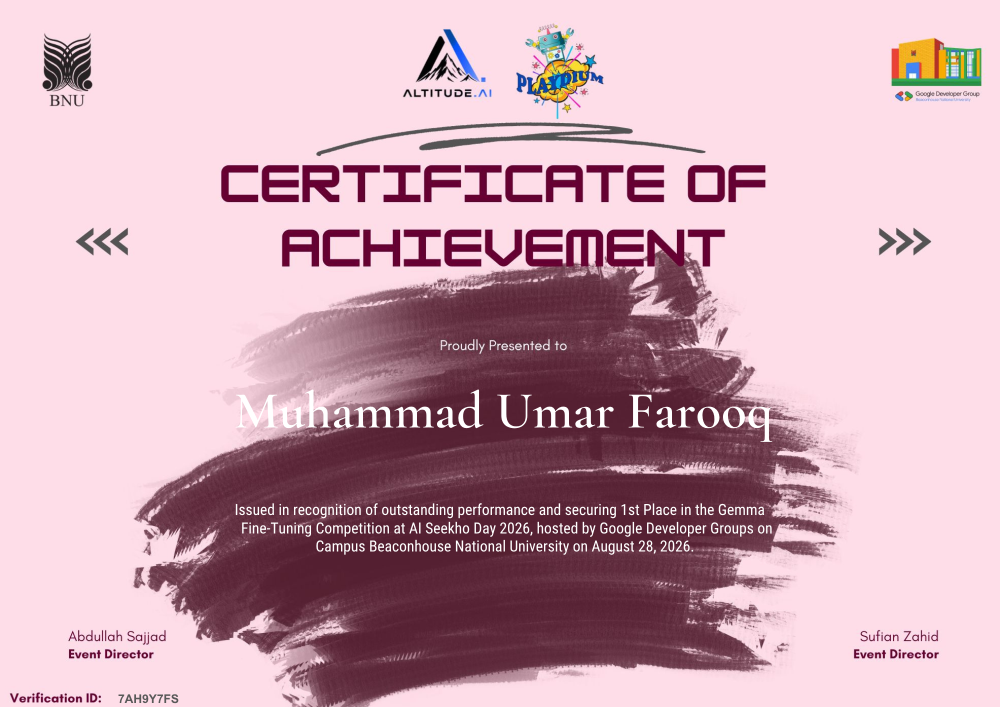

# Gemma Claim Verification

<p align="center">
  
  <a href="#competition-award"></a>
  <a href="https://huggingface.co/google/gemma-4-12B-it"></a>
  <a href="https://huggingface.co/omerfarooq223/gemma-4-12b-evidence-verification-qlora"></a>
  <a href="https://huggingface.co/spaces/omerfarooq223/gemma-claim-verifier"></a>
  <a href="https://github.com/omerfarooq223/gemma-claim-verification"></a>
</p>

Official repository for the research paper:
> **"Failure-Targeted Contrastive Augmentation for Low-Resource Claim Verification"**  
> **Accepted at the 7th International Conference on Innovative Computing (ICIC 2026)** (IEEE).  
> *Authors:* **Muhammad Umar Farooq**, **Hasaan Ahmad**, and **Sadaf Jabeen**  
> *Department of Artificial Intelligence, University of Management and Technology, Lahore, Pakistan*  
> *(To be published in IEEE Xplore following presentation)*

This repository combines the research work from our ICIC 2026 accepted paper with the **1st-place winning solution** in the Gemma Fine-Tuning Competition at **AI Seekho Day 2026**. It provides reproducible scripts, pre-registered experimental protocols, model weights, and an interactive application for evidence-grounded three-way claim verification (`SUPPORTS`, `REFUTES`, `NOT_ENOUGH_INFO`) using parameter-efficient QLoRA fine-tuning on Google Gemma 4 12B. The winning checkpoint scored **94.40% accuracy** and **94.38% macro-F1** on the 500-example event-day test set.

| Resource | Identifier / Link | Description |
|---|---|---|
| **Research Paper** | *Failure-Targeted Contrastive Augmentation for Low-Resource Claim Verification* | Accepted at the 7th International Conference on Innovative Computing (ICIC 2026 / IEEE; to appear in IEEE Xplore) |
| **Base Model** | [`google/gemma-4-12B-it`](https://huggingface.co/google/gemma-4-12B-it) | Google Gemma 4 12B instruction-tuned foundation model |
| **Model Adapter** | [`omerfarooq223/gemma-4-12b-evidence-verification-qlora`](https://huggingface.co/omerfarooq223/gemma-4-12b-evidence-verification-qlora) | 1st-place QLoRA adapter weights on Hugging Face Hub |
| **Live Demo** | [Hugging Face Space](https://huggingface.co/spaces/omerfarooq223/gemma-claim-verifier) | Interactive Gradio verification web application on ZeroGPU |
| **Source Code** | [GitHub Repository](https://github.com/omerfarooq223/gemma-claim-verification) | Complete training, inference, and evaluation repository |

<a id="competition-award"></a>
<p align="center">
  <a href="docs/certificate.png">
    
  </a>
</p>

<p align="center"><em>First place in the Gemma Fine-Tuning Competition at AI Seekho Day 2026.</em></p>

## What it does

The model evaluates a claim against supplied evidence passages and returns one of three relation labels:

| Label | Meaning |
|---|---|
| `SUPPORTS` | The evidence establishes the claim. |
| `REFUTES` | The evidence contradicts the claim. |
| `NOT_ENOUGH_INFO` | The evidence does not settle the claim either way. |

For example:

```text
Claim: The company's revenue declined in 2023.
Evidence: Revenue rose from $1.2 billion in 2022 to $1.5 billion in 2023.

FINAL: REFUTES
```

The model evaluates the claim strictly grounded within the provided evidence passages. It does not browse the web or check external knowledge sources. Evidence-only prompting is part of the training setup, ensuring bounded and traceable reasoning.

## Results

### 1. Single-Checkpoint Competition Benchmark (AI Seekho Day 2026)

These are the recorded results for the selected competition checkpoint:

| Evaluation set | Examples | Accuracy | Macro-F1 |
|---|---:|---:|---:|
| Organizer validation | 300 | 92.33% | 92.27% |
| External stress set | 30 | 93.33% | 93.64% |
| Blind holdout | 120 | 93.33% | 93.37% |
| Event-day test | 500 | **94.40%** | **94.38%** |

On the event-day test, 472 of 500 predictions were correct, with zero invalid or unparseable outputs. Most errors were subtle contradictions classified as support (26 examples with a true label of `REFUTES` were predicted as `SUPPORTS`).

The [experiment history](docs/experiments.md) includes detailed logs for all evaluation sets, earlier checkpoints, and the reproduction run.

### 2. Primary Equal-Compute Evaluation (ICIC 2026 Sealed Test500 Study)

As published in our **ICIC 2026 paper**, we pre-registered an equal-compute study ([`experiments/paper_v1/`](experiments/paper_v1/)) across 4 conditions and 3 random seeds (seeds 42, 43, 44; 12 models total). All models were trained for exactly 136 optimizer updates (2,176 example exposures) under matched hyperparameters using Google Gemma 4 12B IT (pinned at revision `707f0a3b8a3c7ad586ed01e27eafbad8a27dd0f7`).

**Blind Test500 Results Across 3 Seeds (Table III in paper):**

| Condition | Description | Training Rows | Macro-F1 (mean ± SD) | Accuracy (mean ± SD) |
|---|---|---:|---:|---:|
| `REAL` | Cleaned real training data | 935 | 0.9281 ± 0.0146 | 0.9280 ± 0.0144 |
| `REPEAT` | Real data + 150 repeated real instances | 1,085 | 0.9427 ± 0.0143 | 0.9427 ± 0.0140 |
| `LEGACY` | Real data + 150 legacy synthetic instances | 1,085 | 0.9362 ± 0.0251 | 0.9360 ± 0.0251 |
| `TARGETED` | Real data + 150 failure-targeted contrastive trios | 1,085 | **0.9467 ± 0.0117** | **0.9467 ± 0.0117** |

**Pre-registered Hierarchical Paired-Bootstrap Contrasts (10,000 resamples):**

| Contrast | Macro-F1 Effect | 95% Bootstrap CI | Accuracy Effect | 95% Bootstrap CI |
|---|---:|---:|---:|---:|
| `TARGETED - LEGACY` | +0.0105 | [-0.0094, +0.0343] | +0.0107 | [-0.0093, +0.0340] |
| `TARGETED - REPEAT` | +0.0040 | [-0.0183, +0.0260] | +0.0040 | [-0.0180, +0.0260] |
| `TARGETED - REAL` | +0.0186 | [-0.0025, +0.0383] | +0.0187 | [-0.0020, +0.0380] |

*Finding*: While `TARGETED` achieved the highest mean score and lowest seed-to-seed variance, the pre-registered 95% confidence interval spans zero, confirming a favorable mean trend without statistical certainty on the general test distribution.

**Failure-Family Partition Analysis (Table IV in paper):**
Test500 items were partitioned into 320 targeted-family items (7 diagnostic families) vs. 180 other items:
- Within the 320 targeted-family items, `TARGETED` achieved **0.9181 Macro-F1** (vs. 0.9092 for `LEGACY`, 0.9106 for `REPEAT`, and 0.8928 for `REAL`).
- In individual families, *revenue percentage* remained challenging (0.6911 accuracy for `TARGETED` vs. 0.6992 for `LEGACY`), while *project–location* and *range/bound* reached 1.0000 across all conditions.

### 3. Five-Seed Extension, Synthetic Controls & Baselines (ICIC 2026)

To deepen the inquiry after the primary blind study, an exploratory five-seed study (seeds 42–46, 30 models total) evaluated alternative synthetic designs under the same matched 136-step budget (Table V in paper):

| Condition | Macro-F1 (mean ± SD) | Accuracy | Description |
|---|---:|---:|---|
| `REAL` | 0.9328 ± 0.0128 | 0.9328 | Clean real baseline (935 rows) |
| `REPEAT` | 0.9432 ± 0.0102 | 0.9432 | Real + 150 repeated real rows |
| `LEGACY` | 0.9329 ± 0.0185 | 0.9328 | Real + 150 legacy synthetic rows |
| `TARGETED` | 0.9444 ± 0.0095 | 0.9444 | Real + 150 failure-targeted trios |
| `UNTARGETED` | 0.9396 ± 0.0142 | 0.9396 | Real + 150 synthetic rows without failure-family allocation |
| `NOTRIO` | **0.9621 ± 0.0162** | **0.9620** | Real + 150 non-trio failure-targeted synthetic rows |

- **Non-Trio Synthetic Superiority**: The `NOTRIO` condition (allocating examples across the 10 failure families with independent evidence passages rather than shared contrastive trios) achieved the highest exploratory Test500 macro-F1 (**0.9621**), outperforming `TARGETED` across all five matched seeds (contrast: +0.0177, 95% CI: [+0.0039, +0.0325]).
- **Cross-Domain SciFact Transfer**: On 200 balanced SciFact gold-rationale development pairs, `NOTRIO` also led evidence-conditioned transfer with **0.8332 two-class Macro-F1** (vs. 0.8227 `REAL`, 0.8207 `UNTARGETED`, 0.8177 `REPEAT`, 0.8017 `TARGETED`, and 0.8003 `LEGACY`).
- **Prompt-Only Baselines (Table VI in paper)**: Pinned non-fine-tuned Gemma 4 12B IT reached 0.7903 (0-shot), 0.8252 (3-shot), 0.8227 (6-shot), and 0.8098 (9-shot) Macro-F1 on Test500, confirming that QLoRA fine-tuning provides substantial gains (+11.9% to +13.7% Macro-F1) over frozen in-context prompting.

All publication figures (`figure1`, `figure2`, `figure3`), CSV/LaTeX tables, and frozen artifacts are in [`experiments/paper_v1/paper_assets_v1/`](experiments/paper_v1/paper_assets_v1/).

## How to run

Requirements: Python 3.10+ and an NVIDIA CUDA GPU for the 4-bit setup (the reference training environment used a T4 with 16 GB VRAM).

```bash
git clone https://github.com/omerfarooq223/gemma-claim-verification.git
cd gemma-claim-verification
python3 -m venv .venv
source .venv/bin/activate
pip install -e '.[app]'
python app.py
```

Open `http://localhost:7860`. The first model load downloads both the base weights and my adapter:

- Base Model: [`google/gemma-4-12B-it`](https://huggingface.co/google/gemma-4-12B-it)
- Adapter: [`omerfarooq223/gemma-4-12b-evidence-verification-qlora`](https://huggingface.co/omerfarooq223/gemma-4-12b-evidence-verification-qlora)

If Hugging Face prompts for authentication, run `hf auth login` locally. On Spaces, supply an `HF_TOKEN` secret. See [HUGGINGFACE_GUIDE.md](HUGGINGFACE_GUIDE.md) for full deployment details.

### Predict from a file

To run predictions on a JSONL file:

```bash
python scripts/predict.py \
  --test data/examples/sample.jsonl \
  --adapter omerfarooq223/gemma-4-12b-evidence-verification-qlora \
  --config configs/final_inference.yaml \
  --output outputs/submission.csv
```

A local adapter directory can also be passed to `--adapter`. Input format is JSONL with one record per line:

```json
{"id": "example-1", "claim": "Revenue declined in 2023.", "evidence": ["Revenue rose from $1.2B in 2022 to $1.5B in 2023."], "label": "REFUTES"}
```

To evaluate predictions against gold labels:

```bash
python scripts/evaluate.py \
  --gold data/examples/sample.jsonl \
  --predictions outputs/submission.csv \
  --output_json outputs/metrics.json
```

## How I trained it

The main focus was systematic data curation and targeted contrastive examples. The raw training set had 1,000 rows; after my 10-step audit, 935 high-quality examples remained. I generated 150 contrastive examples targeting numerical shifts, swapped entities, and partial evidence, reaching a final training set of **1,085 curated examples**.

| Setting | Value |
|---|---|
| Base model | Gemma 4 12B instruction-tuned |
| Quantization | 4-bit NF4, double quantization, FP16 compute |
| LoRA | Rank 8, alpha 16, dropout 0.05 |
| Target projections | `q_proj`, `k_proj`, `v_proj`, `o_proj`, `gate_proj`, `up_proj`, `down_proj` |
| Learning rate | `2e-4` |
| Effective batch size | 16 |
| Training | 2 epochs, 136 optimizer steps |
| Loss | Assistant completion only: `FINAL: <LABEL>` |
| Inference | Greedy decoding, thinking disabled, up to 24 new tokens |

I trained the final adapter from a fresh base model. For in-depth documentation, see the [data audit](docs/data_audit.md), [methodology](docs/methodology.md), and [final competition notebook](notebooks/final_competition_notebook.ipynb).

### Retraining

The competition data and audited contrastive files are documented in [data/README.md](data/README.md). Once those files are placed in `data/derived/`:

```bash
# Standard training run
python scripts/train_qlora.py \
  --config configs/final_train.yaml \
  --train_clean data/derived/train_clean_v3_semantic.jsonl \
  --contrastive data/derived/d4_contrastive_train_v1.jsonl \
  --output_dir checkpoints/final_adapter

# Controlled equal-compute research run (fixed 136 optimizer steps, pinned revision, seed override)
python scripts/train_qlora.py \
  --config configs/paper_equal_compute.yaml \
  --train_clean data/derived/train_clean_v3_semantic.jsonl \
  --contrastive data/derived/d4_contrastive_train_v1.jsonl \
  --output_dir checkpoints/paper_targeted_seed42 \
  --seed 42
```

To verify the weights of my winning checkpoint against the recorded SHA-256 hash:

```bash
python scripts/verify_artifact.py \
  checkpoints/final_adapter/adapter_model.safetensors \
  --key selected_final_adapter
```

Expected SHA-256:

```text
76630ec4620ff7244f3b6c9ef0350617939d33a5bc6f0e9c545816175b646d8e
```

## Repository guide

| Path | Contents |
|---|---|
| `app.py` | Gradio demo for local use and Hugging Face Spaces |
| `src/gemma_claim_verification/` | Data cleaning, prompts, model loading, training (including fixed-budget execution), inference, and evaluation |
| `scripts/` | Command-line entry points for training, prediction, evaluation, and artifact verification |
| `configs/` | Training and inference configurations (including `final_train.yaml`, `paper_equal_compute.yaml`, and `paper_inference.yaml`) |
| `experiments/paper_v1/` | Pre-registered research protocol, amendments 001–005, run records, result freezes, and publication assets (`paper_assets_v1/`) |
| `tests/` | Unit and integration tests for data processing, fixed-budget plans, modeling, and inference |
| `notebooks/` | Final competition run and development history |
| `docs/` | Competition certificate, methodology, experiments, model card, and provenance |
| `data/` | Sample records, derived manifests, and instructions for competition files |

Run the test suite:

```bash
PYTHONPATH=src python -m unittest discover -s tests -v
```

## Authors & Citation

This research project and codebase are authored by:
- **[Muhammad Umar Farooq](https://github.com/omerfarooq223)** ([Portfolio](https://omerfarooq223.github.io/) · [GitHub](https://github.com/omerfarooq223) · [Hugging Face](https://huggingface.co/omerfarooq223)) — *Department of Artificial Intelligence, University of Management and Technology, Lahore, Pakistan* (`momerfarooq223@gmail.com`)
- **Hasaan Ahmad** — *Department of Artificial Intelligence, University of Management and Technology, Lahore, Pakistan* (`hasaanahmad021@gmail.com`)
- **Sadaf Jabeen** — *Department of Artificial Intelligence, University of Management and Technology, Lahore, Pakistan* (`sadaf.jabeen@umt.edu.pk`)

### Citation

If you use or build upon this research paper, codebase, or model weights, please cite our ICIC 2026 conference paper:

```bibtex
@inproceedings{farooq2026failure,
  author    = {Farooq, Muhammad Umar and Ahmad, Hasaan and Jabeen, Sadaf},
  title     = {Failure-Targeted Contrastive Augmentation for Low-Resource Claim Verification},
  booktitle = {Proceedings of the 7th International Conference on Innovative Computing (ICIC 2026)},
  year      = {2026},
  publisher = {IEEE}
}
```

For referencing the 1st-place competition model adapter:

```bibtex
@misc{farooq2026gemma4claimverification,
  author       = {Farooq, Muhammad Umar},
  title        = {Gemma 4 12B Evidence Verification QLoRA Adapter},
  year         = {2026},
  publisher    = {Hugging Face},
  howpublished = {\url{https://huggingface.co/omerfarooq223/gemma-4-12b-evidence-verification-qlora}}
}
```

## License

- **Code & Adapter Weights**: Licensed under the [Apache 2.0 License](LICENSE).
- **Base Model**: Gemma 4 12B is provided by Google under the [Gemma Terms of Use](https://huggingface.co/google/gemma-4-12B-it).

